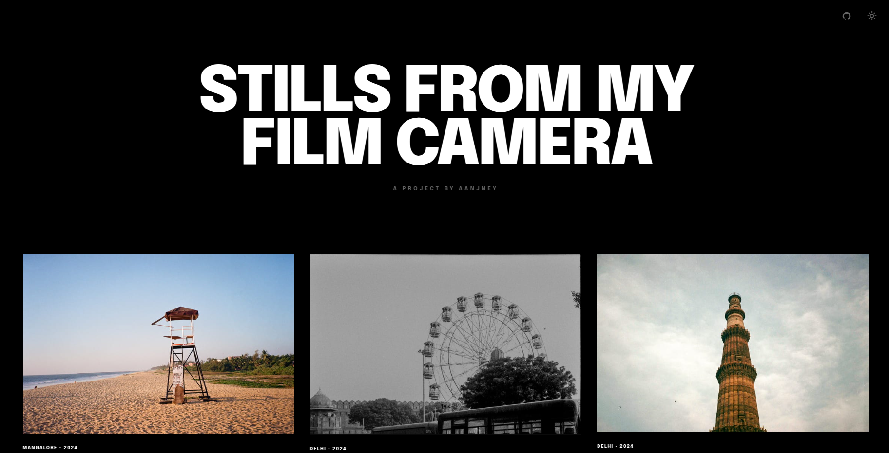
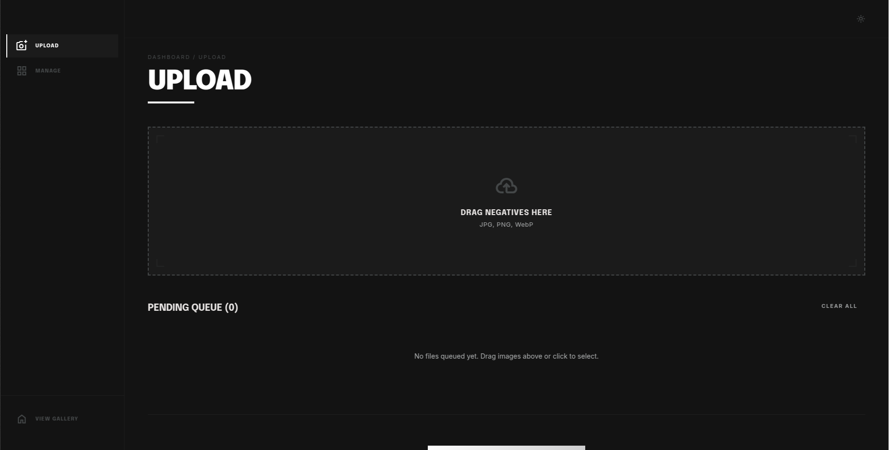
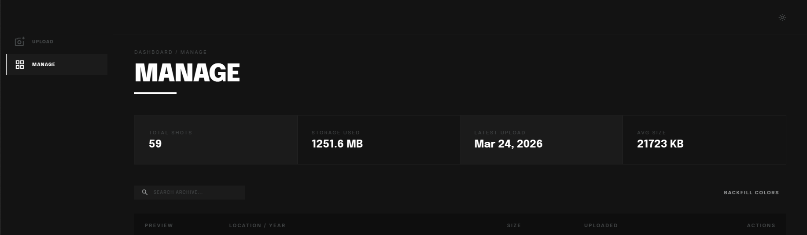

# Cloudflare-image-gallery

A self-hosted image gallery running entirely on Cloudflare's free tier: Workers, R2, Durable Objects, and Image Resizing.
Just wanted to build something to document and showcase my film photography journey.

**Live:** [mr-schwartz.pics](https://mr-schwartz.pics)

## Features

- Responsive masonry gallery that loads every photo by following the API cursor
- Gallery order is shuffled on each page load
- Carousel viewer with `Image.decode()`-based preloading
- Light/dark theme with shared preference across pages
- Admin dashboard with drag-and-drop upload, progress tracking, search, inline metadata editing, and stats
- AVIF/WebP/JPEG negotiation from the `Accept` header
- Responsive `srcset` with several width breakpoints
- Requested widths and qualities on `/img` snap to a fixed allowed set, so random values can't create endless variants
- Cache API edge caching with format-aware cache keys
- Fully free-tier compatible (no paid Cloudflare features required)

## Design

Design is inspired by this brilliant page: [objective.framer.website/people](https://objective.framer.website/people). I also browsed through dozens of other portfolios, stock image platforms, and galleries to get a sense of what I'd want in my own project. Vibe coded most of the UI with Claude, lol, and spent way too long battling random CSS properties and HTML structure.

| Screen  | Preview                        |
| ------- | ------------------------------ |
| Gallery |  |
| Upload  |    |
| Manage  |    |

## Tech stack

Went through a ton of tutorials, guides, and blogs trying to learn about deploying a project like this. Even started developing mindlessly and wasted a ton of time procrastinating when nothing seemed to be working. Finally came across [this video](https://youtu.be/DJtOn_Vt1uw?si=kqS-QjO0yB8mxnMh) and a couple of others from the same creator, which inspired me to take a deeper look into Cloudflare's offerings, and the more I read their documentation, the more I realised this might be the way to go.

| Layer              | Technology                            |
| ------------------ | ------------------------------------- |
| Runtime            | Cloudflare Workers                    |
| Framework          | [Hono](https://hono.dev)              |
| Storage            | Cloudflare R2                         |
| Metadata           | Durable Objects (key-value storage)   |
| Image optimization | Cloudflare Image Resizing + Cache API |
| Auth               | Cloudflare Access (admin routes)      |

Every other option I considered (Vercel, Cloudinary, AWS) would either involve stitching together more services, or I feared exhausting the free tier, or felt like I might have to pay up eventually for infrastructure (especially with AWS ugh).

The only comparable alternative is deploying everything on an Oracle Free ARM VPS. That approach would mean handling everything myself, which is great for learning end-to-end deployment, and I'd actually do it for some other project. It would just lack the edge capabilities (not that people from all across the world, or those nasty AI bots are dying to look at the pictures I clicked).

Cloudflare R2 does support custom metadata on objects, so technically I could have skipped the Durable Object entirely and stored everything alongside the images. But the moment I wanted search, inline editing, and fast listing without scanning the entire bucket on every page load, it made way more sense to use a Durable Object. A little more complexity, but a lot more flexibility.

Right now the Durable Object class is declared as SQLite-backed in the migration, but `ImageIndex` only uses the key-value storage API. It keeps one `order` array of image ids (newest first) plus one `meta:<id>` entry per image. Listing slices that array. There is no custom sort order.

## Project structure

```
src/
  index.ts              Worker entry point and route registration
  types.ts              Shared TypeScript types
  favicon.ts            Favicon SVG
  app/                  Worker helpers: Access JWT verification and admin auth, security
                        headers, cache and Cache-Control values, retries, media
                        responses, request parsing
  do/ImageIndex.ts      Durable Object for image metadata storage
  do/client.ts          Typed client for the index, with retries and failure kinds
  domain/               URLs and limits shared with the browser (contract), image
                        metadata fields, image variants, upload policy, placeholder colors
  photos/lifecycle.ts   Upload, update and delete flows, including the cache purge
  routes/               Hono route modules for gallery, media, admin, and site metadata,
                        plus errors.ts, which turns index failures into HTTP responses
  pages/gallery/        Public gallery markup, styles and browser script
  pages/admin/          Admin markup, styles and browser scripts (upload and manage)
  pages/shared/         Theme and browser helpers used by both pages
assets/                 Screenshots used in this README
test/
  adminClient.test.ts
  cacheCoherence.test.ts
  do.test.ts
  galleryClient.test.ts
  httpCaching.test.ts
  imageRoute.test.ts
  imageVariants.test.ts
  lifecycle.test.ts
  mediaResponse.test.ts
  retry.test.ts
  routes.test.ts
  security.test.ts
  support/fakes.ts      Shared fakes: DO storage, Cache API, in-memory R2
docs/STATE_MACHINES.md  State machines, fixed issues and known limits
```

## Setup

```bash
npm install
```

Your `wrangler.toml` needs at least this:

```toml
account_id = "<your-account-id>"
routes = [
  { pattern = "yourdomain.com/*", zone_id = "<your-zone-id>" },
]

[vars]
ADMIN_PATH = "/your-secret-admin-path"
ACCESS_TEAM_DOMAIN = "your-team"
ACCESS_AUD = "your-access-application-aud-tag"
```

`ADMIN_PATH` is where the admin dashboard lives. It defaults to `/_admin`. Pick something non-obvious, and cover the same path in your Cloudflare Access application (`yourdomain.com/your-secret-admin-path/*`).

`ACCESS_TEAM_DOMAIN` and `ACCESS_AUD` are required. Without them every admin route returns 401. `ACCESS_TEAM_DOMAIN` accepts `your-team`, `your-team.cloudflareaccess.com` or a full `https://` URL. `ACCESS_AUD` is the AUD tag of your Access application, under Zero Trust > Access > Applications > your app > Overview.

For local `wrangler dev` without Access, set `ACCESS_BYPASS_DEV = "true"` in `[vars]`. It skips the auth check entirely. **Never deploy with it enabled.** `wrangler.toml.example` also documents the optional `R2_PUBLIC_HOST`.

## Development

```bash
npm run dev          # Local dev server
npm run check        # Generate Wrangler types
npm test             # Run tests (Vitest)
npm run format       # Format with Prettier
```

## Deploy

1. Copy `wrangler.toml.example` to `wrangler.toml` and set the `[vars]` above.
2. Run `npx wrangler login` once.
3. Run `npm test`, then `npm run deploy`.

## Admin authentication

Cloudflare Access protects the admin dashboard. Configure an Access application that covers `yourdomain.com/<your-admin-path>/*`.

The Worker does not trust Access headers on their own. On every admin route it reads the `Cf-Access-Jwt-Assertion` header and checks the JWT itself:

- the RS256 signature, against your team's public keys from `https://<team>.cloudflareaccess.com/cdn-cgi/access/certs`
- the issuer, against `ACCESS_TEAM_DOMAIN`
- the audience, against `ACCESS_AUD`
- the expiry

Admin requests other than `GET` and `HEAD` must also send an `Origin` header equal to the site's own origin, or they get a 403. Browsers send it. Scripts that call the admin API with an Access service token must set `Origin: https://yourdomain.com` themselves.

## API routes

| Method | Path                         | Auth   | Description                                                 |
| ------ | ---------------------------- | ------ | ----------------------------------------------------------- |
| GET    | `/`                          | Public | Gallery page                                                |
| GET    | `/api/health`                | Public | Health check                                                |
| GET    | `/api/images`                | Public | List images (`cursor`, `limit` default 20 and max 500, `q`) |
| GET    | `/media/:id`                 | Public | Original image from R2                                      |
| GET    | `/img/:id`                   | Public | Resized image (`w`, `q`, `fmt`)                             |
| GET    | `/sitemap.xml`               | Public | Sitemap of up to 500 images                                 |
| GET    | `/robots.txt`                | Public | Robots file pointing at the sitemap                         |
| GET    | `/favicon.svg`               | Public | Favicon                                                     |
| GET    | `/favicon.ico`               | Public | Redirects to `/favicon.svg`                                 |
| GET    | `/<admin>/`                  | Admin  | Dashboard UI                                                |
| GET    | `/<admin>/ping`              | Admin  | Auth check                                                  |
| GET    | `/<admin>/api/stats`         | Admin  | Image count, total bytes, average size, latest upload       |
| POST   | `/<admin>/api/upload`        | Admin  | Upload one image as multipart form data                     |
| POST   | `/<admin>/api/images/update` | Admin  | Update image metadata (JSON body)                           |
| POST   | `/<admin>/api/images/delete` | Admin  | Delete image (JSON body)                                    |

`<admin>` is your `ADMIN_PATH`.

`/img/:id` parameters:

- `w`: width. Snaps to the nearest of 120, 160, 240, 320, 480, 720, 800, 960, 1200, 1600. It never exceeds the original width.
- `q`: quality. Snaps to the nearest quality defined for the snapped width, between 70 and 82. Without `w`, the original size is served at quality 85.
- `fmt`: `webp` forces WebP. Anything else picks the format from the `Accept` header, preferring AVIF, then WebP, then JPEG.

Uploads accept JPEG, PNG and WebP, one file per request, up to 50 MiB each. The admin UI labels this limit "50 MB".

Text fields (name, alt, camera body, film stock, location, year) are trimmed on upload and on edit, and both have the same length limits: 255 characters for name, 1,000 for alt, 200 for camera body, film stock and location, and 32 for year. A field that is too long gets a 400 that names it.

If the index is down, the admin stats, update, upload and list calls answer 503 `Index unavailable`. A delete that fails halfway answers 500, and retrying it finishes the job.

## Caching

- Images from `/media/:id` and `/img/:id` are sent with `max-age` of 1 year and `s-maxage` of 1 day. Image URLs never change bytes.
- The gallery's first list page, `/api/images?limit=200`, is cached for 60 s at the edge and 30 s in the browser. Other list pages are not edge-cached, and search results are `private, no-store`.
- The gallery page `/` is `no-cache`, so browsers revalidate on every visit.
- Admin responses are `private, no-store`.
- Every response, including 304s, 404s and redirects, carries the security headers (HSTS, `nosniff`, referrer and permissions policies).

## Known limitations

- Deleting a photo purges the edge cache only in the data center that handled the delete. Other data centers can serve their copy for up to 1 day. Browsers that already loaded it can keep it for a year.
- The photo list has the same problem. Uploads, edits and deletes purge the cached first page only in the local data center, so other data centers can show a stale list for up to 60 seconds.
- Search loads and scans every image's metadata on each request. That is fine for a personal gallery but does not scale.
- The index holds at most 5,000 images (`LIST_LIMITS.maxPhotos` in `src/domain/contract.ts`). Uploads past that fail with a 409.

[docs/STATE_MACHINES.md](docs/STATE_MACHINES.md) has the full list.
